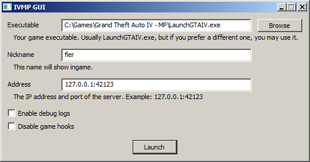

# IVMP

Open source multiplayer server/client for Grand Theft Auto IV.

## Compatibility

Windows XP and newer are supported. The server works on Windows and UNIX systems.

The following versions of GTA IV are currently supported:  
* 1.0.7.0
* 1.0.4.0 (untested)

## Run client

Put `xlive.dll` next to `GTAIV.exe`. Run `ivmp_gui.exe`, enter the appropriate data, and click Launch. You can now use your phone to create and find player matches in LIVE.

You may also use this `xlive.dll` for singleplayer, it contains an ASI loader.

## Run server

Copy `server.conf.example` next to your `ivmp_server` executable and name it `server.conf`. Edit `server.conf` appropriately, then run `ivmp_server server.conf`.

## Architecture

The client consists of an xlive.dll, it wraps the required LIVE APIs to play the game. Multiplayer traffic, including peer-to-peer is piped into a server, which manages communication between clients.

Most of the functionality works standalone through xlive.dll, but some aspects of the game are patched through it as well:

* Removed RGSC requirement (important)
* Disabled detection of modded game (can cause host to be kicked from own lobby)
* Disabled detection of computer running too slow (makes alt tab without further patches less annoying)

## Compiling

You can compile the client and server yourself, it's "easy".

### Prerequisites

* UNIX shell (on Windows, you may use busybox-w32)
* C99 compiler (for the server)
* 32-bit MinGW GCC (for the game client)

### How to compile

Simply run `./build.sh` with the wished-for arguments. If you supply no arguments, everything is compiled.

* server: Build system-native server
* windows: Build Windows server and client
* test: Run tests
* all: Build all
* clean: Remove all binaries and build artifacts

## Credits

* xliveless code from [Ultimate ASI Loader](https://github.com/ThirteenAG/Ultimate-ASI-Loader)
